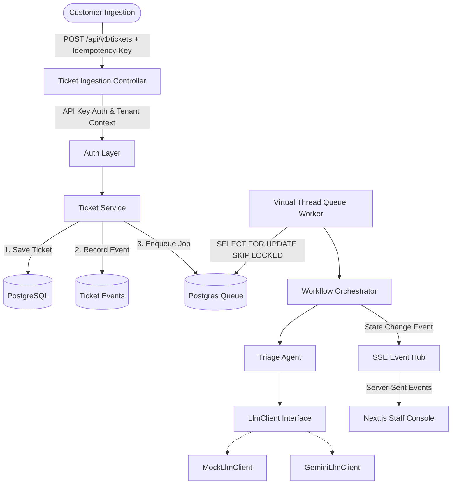
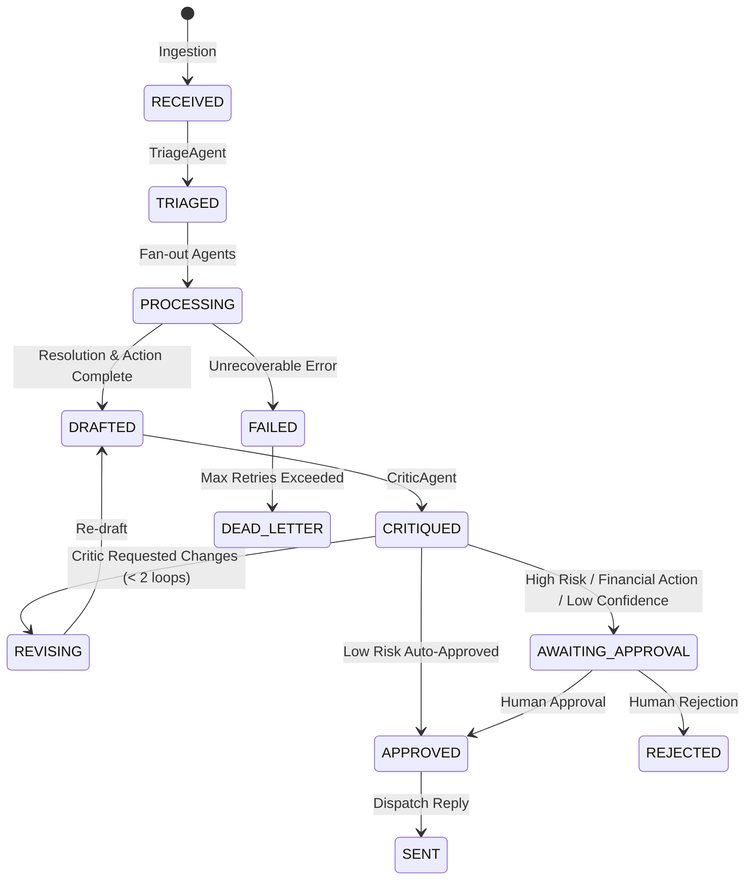

# SupportPilot Architecture

SupportPilot is an event-driven, multi-tenant AI customer support platform built on Hexagonal Architecture (Ports and Adapters).

## 1. System Overview

## 2. Ticket Lifecycle State Machine

## 3. Concurrency Rationale

1. **Java 21/25 Virtual Threads for I/O & Queue Workers:**
   Ingestion and LLM waiting are I/O bound. Using virtual threads per task (`Executors.newVirtualThreadPerTaskExecutor()`) allows thousands of concurrent operations with negligible memory overhead compared to platform threads (~2KB vs ~1MB).
2. **Optimistic Locking (`@Version`):**
   `tickets` table has a `version` column. When concurrent updates or human reviews occur, Spring Data JPA prevents lost updates without table-level database locking.
3. **Queue Concurrency via `SKIP LOCKED`:**
   `PostgresTicketQueue` uses `SELECT ... FOR UPDATE SKIP LOCKED` with a configurable concurrency limit. Workers never block each other waiting on the same row, eliminating lock contention.
4. **Idempotency Guarantee:**
   Ingestion requires an `Idempotency-Key` header. Duplicate requests within a 24-hour window return the existing ticket immediately without re-enqueuing.
